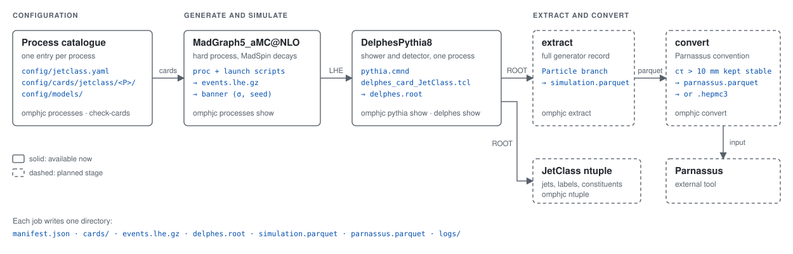

# omphjc

Sample generation for JetClass-style jet datasets with two detector
simulations: Delphes, as in the original JetClass production, and Parnassus.
One set of generated events feeds both, so the two detector responses can be
compared on identical physics.

The pipeline is MadGraph5_aMC@NLO → Pythia 8 → Delphes, run as
`DelphesPythia8` with the official JetClass Delphes card. The full simulated
event (hard process, decays, parton shower and hadronisation) is extracted from
the Delphes output into a columnar file, from which the Parnassus input is
derived in Parnassus's own stable-particle convention.

## Pipeline



| Step | What it does | Configuration it reads | What it writes |
|---|---|---|---|
| Process catalogue | Defines each process: model, process lines, run-card cuts, MadSpin card, matching, seed offset | `config/jetclass.yaml`, `config/models/`, `config/madspin/` | the MadGraph scripts and Pythia settings of every later step |
| MadGraph5_aMC@NLO | Generates the hard process (and MadSpin decays) at parton level | process and launch scripts written from the catalogue | `events.lhe.gz`, the banner (cross section, seed, run card as used) |
| DelphesPythia8 | Showers and hadronises with Pythia 8 and simulates the detector, in one process, so MLM matching runs where the catalogue asks for it | `pythia.cmnd` (from `common.pythia`, the matching block and the run's seed), `config/delphes/delphes_card_JetClass.tcl` (`common.delphes_card`) | `delphes.root` with the full generator record in its `Particle` branch |
| extract *(planned)* | Reads the generator record out of the Delphes file | — | `simulation.parquet`: every particle with mothers, daughters and vertices |
| convert *(planned)* | Applies Parnassus's stable-particle convention (cτ > 10 mm) | — | `parnassus.parquet`, or `.hepmc3` for the current Parnassus reader |
| ntuple *(planned)* | Builds the JetClass jet table (jets, labels, constituents) from the Delphes output | — | `jetclass.parquet` |

Every stage of a job writes into one directory with a manifest recording
versions, seeds, card hashes, cross sections and event counts. Dashed boxes in
the diagram are the stages not yet available; the sections below cover the
available ones.

## Installation

```
pip install -e .
```

The package itself needs Python 3.10 or later. Generating events additionally
needs MadGraph5_aMC@NLO, Pythia 8 and Delphes built with Pythia support; the
`environment/` directory documents a pinned installation.

## Configuration

Everything a run reads, and the official JetClass cards it can be compared
with, lives in `config/`:

```
config/
├── jetclass.yaml                      the process catalogue
├── models/                            MadGraph models (UFO), one folder each
│   ├── heft/                          model files and restriction cards (parameter values)
│   └── heft_c_mass_jetclass/
├── madspin/                           MadSpin cards
├── delphes/                           Delphes cards
├── references/jetclass/               official JetClass cards, for comparison
│   ├── <process>/                     gridpack cards: proc, run, param, pythia8, launch, MadSpin
│   ├── delphes_card.tcl
│   └── LICENSE
└── PROVENANCE.md                      origin and SHA-256 of every shipped file
```

`jetclass.yaml` has two blocks: `common`, with the settings every process
shares, and `processes`, with one entry per process (see
[Adding a process](#adding-a-process)). The `common` block holds:

| Key | Content |
|---|---|
| `models_dir` | Folder of the models imported by path; `models` by default |
| `delphes_card` | Delphes card of every run |
| `definitions` | MadGraph multiparticle definitions for every process, written before each entry's own (see [Models](#models)) |
| `run_card` | Run-card values for every process |
| `pythia` | Pythia settings for every process (see [Pythia settings](#pythia-settings)) |
| `pythia_matching` | Pythia settings added for MLM-matched processes |

Comments in the file give the source of the shipped values: an official card
or a line of MadGraph's source code.

Files are named by a path, either absolute or relative to the catalogue's own
folder: an entry's `madspin_card` and `reference_cards`, and the common
`delphes_card` and `models_dir`. The files in `madspin/` and `delphes/` start
as copies of the official ones; edit them in your own copy to change decays or
the detector, and `references/` keeps the originals for `omphjc check-cards`
and `omphjc delphes compare`.

An installed package carries a copy of this directory. To work from a modified
catalogue, export the configuration and point the command line at it:

```
omphjc config path                        # where the shipped copy lives
omphjc config export ./my_config          # copy it for editing
omphjc --catalogue ./my_config/jetclass.yaml processes
export OMPHJC_CATALOGUE=./my_config/jetclass.yaml   # same, for every command
```

### Models

A model folder holds the model's Python files (its particles, parameters and
interactions) and its restriction cards, `restrict_<name>.dat`. A restriction
card gives every parameter of the model a value; MadGraph applies it on import
and removes the parameters set to 0, with every interaction that vanishes with
them. An entry's `model: heft-ckm` imports `models/heft/` by path, with
`models/heft/restrict_ckm.dat`, so MadGraph never downloads it; plain `heft`
uses `restrict_default.dat`. A name with no folder under `models/`, such as `sm` or
`sm-ckm`, is left to MadGraph. To run with other parameter values, add a card
such as `models/zprime/restrict_m2tev.dat` and use `model: zprime-m2tev`.
`heft` is vendored because MadGraph would download it on first use, and
`heft_c_mass_jetclass` because the HToCC charm-mass model exists only inside
the official gridpack.

MadGraph includes the b quark in its own `p` and `j` only when the model's b
is massless. Every model in the shipped catalogue keeps it massive (4.7 GeV),
so `common.definitions` adds b and b̄ to both, as the official production
does; without it, ZToQQ would contain no Z → bb̄ decays. An entry can redefine
either name in its own `definitions`, which are written after the common ones.

## Processes

```
omphjc processes              # list the catalogue
omphjc processes show HToBB   # MadGraph inputs written for one process
omphjc check-cards            # differences from the official cards, if any
```

`check-cards` compares, value by value, every process that names
`reference_cards` with those cards: it reports each physics setting that
differs from the official cards and each tracked official setting the entry
leaves out, and it lists the processes without reference cards. The shipped
catalogue reports no differences.

### Seeds

Job *n* of a process seeds MadGraph, Pythia and Delphes with
`seed_offset + n`, so the seeds of a job follow from its process and number
alone. `seed_offset` is 0 unless the entry sets it. The shipped catalogue
follows the official production, which offset the n-th Higgs process by
10 000 000 × n (HToBB 10 000 000, …, HToWW2Q1L 50 000 000) and no other
process. Giving a process an offset of its own keeps its seeds apart from those
of the other processes.

## Adding a process

A process is one catalogue entry; no code changes are involved. Export the
shipped configuration (`omphjc config export ./my_config`) or write a catalogue
of your own, then point the command line at it with `--catalogue`:

```yaml
processes:
  ZPrimeToTT:
    label: Zptt
    description: "$Z' \\to t\\bar{t}$ with up to one extra jet"
    model: zprime-m2tev
    definitions: ["tops = t t~"]
    processes:
      - "p p > zp > tops tops @0"
      - "p p > zp > tops tops j @1"
    run_card: {ickkw: 1, xqcut: 40.0, pt_min_pdg: {6: 450.0}}
    matching: true
    madspin_card: madspin/ZPrimeToTT.dat
    reference_cards: references/zprime
    seed_offset: 60000000
```

An entry needs the first four keys below; the others are optional.

| Key | Content | Default |
|---|---|---|
| `label` | Class name of the sample, unique within the catalogue | required |
| `description` | The physics, with formulas in LaTeX syntax | required |
| `model` | MadGraph model, with an optional restriction suffix (see [Models](#models)) | required |
| `processes` | MadGraph process lines; the first is generated and the others are added to it | required |
| `definitions` | Multiparticle definitions, without the leading `define`, written after `common.definitions` | none |
| `run_card` | Run-card values, added to `common.run_card` and overriding it | none |
| `pythia` | Pythia settings, added to `common.pythia` and overriding it | none |
| `matching` | `true` for an MLM-matched sample: the Pythia settings gain `common.pythia_matching` and the matching values derived from the run card | `false` |
| `madspin_card` | MadSpin card; MadSpin runs only for an entry that names one | none |
| `reference_cards` | Folder of official cards that `omphjc check-cards` compares the entry with | none |
| `seed_offset` | Added to the job number to give the job's seeds (see [Seeds](#seeds)) | 0 |

A process you add provides at most a model folder (only when MadGraph does not
ship the model) and a MadSpin card (only when it decays heavy particles); the
package writes the MadGraph scripts and the Pythia command file.

## Pythia settings

Events are showered inside `DelphesPythia8`, which takes a Pythia command file
rather than MadGraph's run card. `omphjc pythia show` prints the file the
package writes for a process:

```
$ omphjc pythia show ZJetsToNuNu --events 1000 --seed 1
! Pythia 8 settings for DelphesPythia8: ZJetsToNuNu
!
JetMatching:qCut = 45
JetMatching:nJetMax = 2
JetMatching:nQmatch = 5
Beams:setProductionScalesFromLHEF = on
JetMatching:merge = on
JetMatching:scheme = 1
JetMatching:coneRadius = 1
JetMatching:doShowerKt = off
Beams:frameType = 4
Check:epTolErr = 0.01
JetMatching:setMad = off
JetMatching:etaJetMax = 1000
Beams:LHEF = events.lhe
Main:numberOfEvents = 1000
Random:setSeed = on
Random:seed = 1
```

The lines are written in the order they apply: like Pythia, read a later line
as overriding an earlier one.

- The first eight lines are the MLM matching block, written only for a process
  with `matching: true` in the catalogue (ZJetsToNuNu). `JetMatching:qCut` is
  1.5 × the run card's `xqcut`, `JetMatching:nJetMax` the largest number of
  jets in the process lines and `JetMatching:nQmatch` the run card's
  `maxjetflavor`; the next five are MadGraph's fixed matching choices.
- `Beams:frameType`, `Check:epTolErr`, `JetMatching:setMad` and
  `JetMatching:etaJetMax` are the settings MadGraph's own Pythia interface adds
  to every run; they are written for every process.
- `Beams:LHEF`, `Main:numberOfEvents` and `Random:*` describe the run:
  `--lhe`, `--events` and `--seed`. Without `--seed` the shower is seeded from
  the clock (`Random:seed = 0`).

### Changing the settings

The fixed values live in `config/jetclass.yaml`: `common.pythia` holds the
settings written for every run, `common.pythia_matching` the fixed part of the
matching block, each block with a comment naming the MadGraph source line its
values come from. Three places change them, later ones winning:

1. The catalogue blocks themselves, in your own copy
   (`omphjc config export ./my_config`, then `--catalogue ./my_config/jetclass.yaml`).
2. A `pythia:` block in one process entry, for that process only:

   ```yaml
     HToBB:
       model: heft
       processes:
         - "p p > ve ve~ h, h > b b~"
       pythia:
         Main:timesAllowErrors: 100
   ```

3. The command line, for one run: `omphjc pythia show HToBB --set Main:timesAllowErrors=100`.

The derived matching values (`qCut`, `nQmatch`, `nJetMax`) follow the run card
and the process lines; they can be overridden the same way.

## Delphes cards

A run uses the card named by the catalogue's `common.delphes_card`, shipped as
`config/delphes/delphes_card_JetClass.tcl`, a copy of the official JetClass
card; point it at any other card to change the detector. Cards are compared as
configuration, the way Delphes reads them, so layout, comments and definition
order never count as differences:

```
omphjc delphes show                    # the official card: execution path, modules, parameters
omphjc delphes show my_card.tcl        # any other card
omphjc delphes compare my_card.tcl     # differences from the official card
```

Reading a card uses the Tcl interpreter that ships with Python (`tkinter`).

## Layout of a job

Each job produces, in its own directory, the MadGraph event file, the Delphes
output, the simulation-only record and the Parnassus input, together with a
manifest recording versions, seeds and cross sections.

## Acknowledgements

The process definitions, cards and Delphes configuration follow the JetClass
production by the jet-universe project (MIT),
[jet-universe/jetclass_generation](https://github.com/jet-universe/jetclass_generation);
`config/PROVENANCE.md` records the exact files taken from it.
The vendored `heft` model is the MadGraph5_aMC@NLO Higgs effective-field-theory
model. Developed with the assistance of Claude Code.

## License

MIT. See `LICENSE`.
